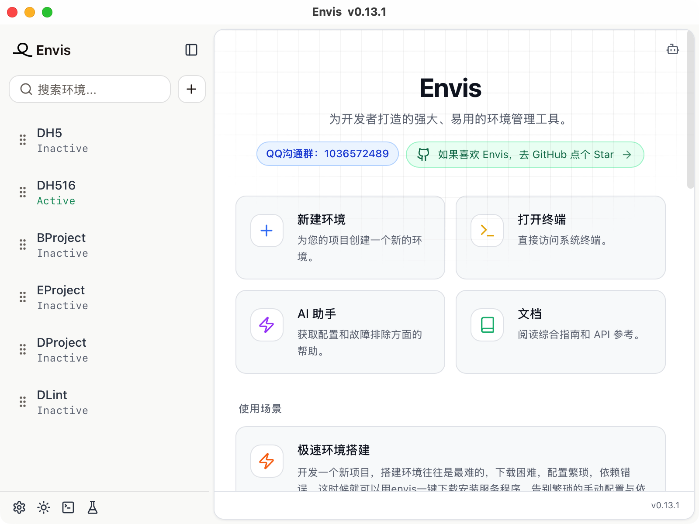

# Envis

<p align="center">
  
</p>

<p align="center">
  <strong>为开发者打造的跨平台环境与服务管理工具</strong>
</p>

<p align="center">
  [English](./README.md) | 中文文档
</p>

<p align="center">
  
  
  
  
</p>

## 📸 应用截图

<p align="center">
  
</p>

## 💡 为什么需要 Envis

<div align="center">

| 痛点 | Envis 的做法 |
| --- | --- |
| 新项目搭环境最费劲：下载困难、代理麻烦、依赖冲突 | **一键安装** —— 自动下载、解压、配置并启动服务 |
| 项目 A 要 Node 14 + Java 8 + MySQL，项目 B 要 Node 20 + Java 11 + MariaDB | **一键切换环境** —— 每个环境独占自己的程序、数据目录、端口与配置文件 |
| 每台机器都手动配一遍，配完还要面对「在我电脑上能跑」 | **导出 / 导入环境配置** —— 新机器一键还原出完全一致的环境 |
| 服务散落在 `brew services`、`systemctl`、Docker Desktop 和各种终端窗口里 | **一个窗口**搞定安装、启停、配置、数据浏览、日志与终端 |

</div>

## 🧩 支持的服务

Envis 把服务分成两类：**可运行服务**能直接在界面里启动、停止、重启；**工具链服务**负责安装与配置，实际使用在终端里完成。

| 服务 | 类别 | 面板内容 |
| --- | --- | --- |
| **MySQL** · **MariaDB** | 可运行 | 初始化、启停、端口与数据目录、数据库、用户与权限 |
| **PostgreSQL** | 可运行 | 初始化、启停、配置、数据库、角色 |
| **MongoDB** | 可运行 | 初始化、启停、数据/日志路径、数据库、集合、用户 |
| **Redis** | 可运行 | 初始化、启停、持久化（RDB / AOF）、Key 浏览 |
| **Nginx** | 可运行 | 启停、配置文件解析、server block、listen / server_name |
| **Dnsmasq** | 可运行 | 启停、配置文件、macOS `/etc/resolver` 引导 |
| **Node.js** | 工具链 | 版本安装、全局 npm 包 |
| **Python** | 工具链 | 版本安装、pip 源配置、虚拟环境 |
| **Java** | 工具链 | 版本安装、Maven / Gradle 信息 |
| **Rust** | 工具链 | 工具链安装、`rustc` / `cargo` 版本信息 |
| **NASM** | 工具链 | 版本安装 |
| **自定义服务** | 工具链 | 可执行路径、环境变量、别名、工作目录、自动 `cd` |
| **Hosts 管理** | 工具链 | 可视化编辑 `/etc/hosts`（需要管理员权限） |
| **SSL 证书** | 工具链 | 本地 CA、签发证书、证书列表 |

## ✨ 功能

### 环境管理
- 多个完全隔离的环境，各自拥有独立的服务程序、版本与数据目录
- 一键激活 / 停用；可选在启动时自动激活上次使用的环境
- 可选「激活某环境时自动停用其他环境」，或「退出时停止所有服务」
- 拖拽排序、搜索，以及按环境**导出 / 导入**配置

### 服务管理
- 一键下载、校验、解压、安装，带实时下载进度
- 按服务选择版本，启动 / 停止 / 重启
- 直接在界面里编辑配置，有校验反馈
- 数据面板：数据库、用户与权限、集合、Key、npm 包、虚拟环境

### 开发配套
- **AI 助手**面板 —— 兼容任意 **OpenAI** 或 **DeepSeek** 接口。可分析问题、解释配置、起草命令，聊天记录只留在本机
- **内置终端** —— 打开就已作用于当前激活环境，可选显示环境名与服务信息
- **日志与诊断面板** —— 应用日志外加一份状态检查器，便于排查
- **系统监控** —— CPU、内存、磁盘 I/O、网络一目了然
- **代理支持** —— `none` / `http` / `socks5` / `system`，用于服务下载与接口调用
- **主题** —— 亮色、暗色或跟随系统
- **多语言** —— 中文与英文，键值完全对齐

## 📱 移动端（Android 终端客户端）

仓库里还包含一个移动端构建：登录 → 主机列表 → 环境列表 → 终端，通过移动端终端会话接口连接到你自己的机器。它与桌面端共用同一套设计系统与发布流程。

```bash
pnpm dev:mobile      # 移动端入口的 Vite 开发服务器
pnpm build:mobile    # 移动端入口的生产构建
pnpm android:init    # 一次性：生成 Android 工程
pnpm android:dev     # 在设备 / 模拟器上运行
pnpm android:build   # 构建 Android 安装包
```

## 🏗 架构

Envis 是「Rust 核心 + 一层很薄的前端」。前端不直接碰文件系统、也不直接拉起进程——所有特权操作都走类型化的 IPC 封装。

```
┌──────────────────────────────────────────────────────────┐
│ React UI            src/pc/**            src/mobile/**   │
│   Jotai 状态 · i18next · Tailwind token · Radix UI        │
├──────────────────────────────────────────────────────────┤
│ IPC 层              src/pc/ipc/**（类型化的 invoke 封装）  │
├──────────────────────────────────────────────────────────┤
│ Tauri 命令          src-tauri/src/**（约 240 个命令）     │
│   窗口 · 托盘 · 更新 · 对话框 · 进程拉起                   │
├──────────────────────────────────────────────────────────┤
│ envis-core          src-tauri/crates/envis-core（子模块）  │
│   manager/** · types/** · utils/**                       │
└──────────────────────────────────────────────────────────┘
```

- **安装状态是「推导出来的」，不存在前端里。** 哪些已安装、哪些在运行，由 `envis-core` 给出，界面只负责如实呈现。
- **一切样式来自 token。** 组件只读 `src/global.css` 的三级 token，没有组件写死颜色。
- **两个前端，一套设计系统。** 桌面端与移动端共用 token、原语组件与发布流程。

## 🛠 技术栈

| 层 | 选型 |
| --- | --- |
| 桌面外壳 | **Tauri 2**（Rust，含 tray-icon、updater、opener、dialog、process 插件） |
| 前端 | **React 18** + **TypeScript** |
| 构建 | **Vite 6**（两个入口：`index.html` 桌面端，`mobile.html` 移动端） |
| 样式 | **Tailwind CSS 3** + **Radix UI** 原语 |
| 状态 | **Jotai** |
| 国际化 | **i18next** / react-i18next（`zh-CN`、`en`） |
| 动效 | **Framer Motion** |
| 列表与布局 | **react-virtuoso**、**react-resizable-panels**、**dnd-kit** |
| 表单 | **react-hook-form** |
| Markdown 与高亮 | **react-markdown** + **rehype-highlight** |
| 图标 | **lucide-react** |
| 通知 | **sonner** |

## 🚀 快速开始

### 环境要求

- **Node.js 20+**
- **pnpm**（本仓库由 pnpm 管理，以 `pnpm-lock.yaml` 为准）
- **Rust** 稳定版工具链 —— Tauri 需要
- Tauri 2 的平台构建依赖，请参考官方 [Tauri 环境准备](https://tauri.app/start/prerequisites/)（macOS 需要 Xcode Command Line Tools；Windows 需要 WebView2 + MSVC；Linux 需要 WebKitGTK、`libssl-dev` 等）

### 克隆

Rust 核心位于一个 **git 子模块**（`src-tauri/crates/envis-core`，分支 `enterprise`），必须与应用一起检出。构建桌面端需要该仓库的访问权限。

```bash
git clone --recurse-submodules https://github.com/xopenbeta/envis-app.git
cd envis-app
```

如果克隆时漏了子模块：

```bash
pnpm git:pull        # 等价于 git pull --recurse-submodules
```

### 安装并运行

```bash
pnpm install
pnpm dev:pc          # 完整桌面应用（Tauri + Vite）
```

## 📝 可用脚本

| 脚本 | 作用 |
| --- | --- |
| `pnpm dev` | 只启动**桌面端**入口的 Vite 开发服务器（不含 Tauri 外壳） |
| `pnpm dev:pc` | 完整桌面开发：Tauri 外壳 + Vite |
| `pnpm dev:mobile` | **移动端**入口的 Vite 开发服务器 |
| `pnpm build` | 守卫检查 → `tsc` → 桌面端生产构建 |
| `pnpm build:mobile` | 守卫检查 → `tsc` → 移动端生产构建 |
| `pnpm preview` | 预览生产构建 |
| `pnpm check:i18n` | 词条健全性检查（见[开发约定](#-开发约定)） |
| `pnpm check:a11y` | 无障碍扫描（见[开发约定](#-开发约定)） |
| `pnpm pack` | 打包桌面应用（`tauri build`） |
| `pnpm tauri` | 执行任意 Tauri CLI 命令 |
| `pnpm icon` | 从图标源重新生成全平台图标 |
| `pnpm android:init` / `android:dev` / `android:build` | Android 工程生命周期 |
| `pnpm publish -- v0.13.16` | 发布新版本（改版本号、打 tag、推送） |
| `pnpm git:pull` | `git pull --recurse-submodules` |

## 📁 项目结构

```
envis-app/
├── index.html                桌面端入口
├── mobile.html               移动端入口
├── app-icon.png              图标源（1024×1024）——全平台图标由它生成
├── E.svg                     应用图标的矢量母版
├── src/
│   ├── global.css            设计 token（三级：原始值 → 语义 → 组件）
│   ├── theme.ts              亮色 / 暗色 / 跟随系统
│   ├── pc/                   桌面端
│   │   ├── pages/            nav-bar · env-panel（15 个服务面板）· ai-panel · log-panel
│   │   ├── components/ui/    基于 Radix 的原语组件
│   │   ├── hooks/            设置、服务、状态、环境数据
│   │   ├── ipc/              Tauri 命令的类型化封装
│   │   └── i18n/locales/     en.json · zh.json
│   └── mobile/               Android 终端客户端
├── src-tauri/                Rust 外壳
│   ├── icons/                生成的平台图标
│   └── crates/envis-core/    核心逻辑（git 子模块）
├── scripts/                  发布工具与仓库守卫
└── doc/design/               UI 设计语言与审计
```

## ⚙️ 配置与数据

### 构建目标

`vite.config.ts` 只根据一个变量分支，由按模式区分的 env 文件提供：

| 文件 | `VITE_APP_TARGET` | 源码根 | HTML 入口 | 产物目录 |
| --- | --- | --- | --- | --- |
| `.env.pc` | `pc` | `src/pc` | `index.html` | `dist/` |
| `.env.mobile` | `mobile` | `src/mobile` | `mobile.html` | `build/` |

`@` 别名指向当前目标的源码根，所以 `@/components/ui/button` 在桌面端解析到
`src/pc/components/ui/button`，在移动端解析到 `src/mobile/components/ui/button`。

### 设置存在哪

- **应用设置**（主题、语言、AI 服务商 / 密钥 / 模型）属于 UI 层，存在 local storage。
- **系统设置**（`envisFolder`、开机自启、激活时停用其他环境、退出时停止服务、终端程序、代理模式与地址）由 Rust 核心持久化。

### 磁盘布局

下载的程序与各环境的数据都放在你指定的 `envisFolder` 下：

```
<envisFolder>/
└── envs/
    └── <environmentId>/
        └── <serviceType>/          例如 mysql、redis、nodejs
            └── <version>/          该版本的程序与数据目录
```

因此每个环境都是自包含的：停用它、删掉它，都不会留下游离进程或共享状态。

## 🧭 开发约定

### 仓库守卫

两类缺陷在 code review 里根本看不出来，所以它们由脚本在每次生产构建前拦截：

```bash
pnpm check:i18n   # 重复键 · en/zh 键对齐 · 每个 t('…') 都能解析到真实词条
pnpm check:a11y   # 每个对话框都有标题 · 每个纯图标控件都有可访问名
```

`t('some.key')` 指向不存在的键时，i18next 会把**原始 key 字符串直接渲染给用户**；而重复键会被 `JSON.parse` 静默吞掉。两者都不会在 diff 里显形，因此靠脚本强制。

### 国际化

`src/pc/i18n/locales/en.json` 与 `zh.json` 必须**双向键完整**，否则 `pnpm check:i18n` 会让构建失败。组件里不要写死面向用户的字符串。

### 设计系统

所有 UI 改动遵循 [`doc/design/UI-LANGUAGE.md`](./doc/design/UI-LANGUAGE.md)：色彩、表面层级、字号阶梯、间距、圆角、动效、组件、状态语义、暗色模式与无障碍规则。用浏览器打开 [`doc/design/preview.html`](./doc/design/preview.html) 可以直接看到由真实 token 渲染的视觉速查页。[`doc/design/UI-AUDIT.md`](./doc/design/UI-AUDIT.md) 记录了审计发现与修复进度。

### 图标

平台图标是生成物，不要手改：

```bash
pnpm icon                 # 读取 ./app-icon.png
pnpm tauri icon E.svg     # 或直接从矢量母版渲染
```

macOS 的**托盘**图标（`src-tauri/icons/envis.png`）是通过 `include_bytes!` 编译进二进制的**透明底字形**，而且 macOS 以 template 模式渲染它——**只取 alpha 通道**。不要用带底色的方形 app 图标替换它，否则菜单栏里会显示成一坨实心方块。

## 📦 构建与发布

```bash
pnpm build           # 类型检查 + 前端构建
pnpm pack            # 打包桌面应用
pnpm publish -- v0.13.16   # 打 tag 并发布；CI 构建 macOS / Windows / Linux
```

版本历史见 [CHANGELOG.md](./CHANGELOG.md)。

## ❓ 常见问题

**Rust 侧构建失败，或找不到 `src-tauri/crates/envis-core`。**
核心是一个 git 子模块。执行 `pnpm git:pull`（或克隆时加 `--recurse-submodules`）。构建需要 `envis-core` 仓库的访问权限。

**`pnpm build` 卡在 `check:i18n` 或 `check:a11y`。**
这正是守卫在起作用。输出会指明文件、行号和 key——否则 `t('some.key')` 会把原始 key 直接渲染给用户，而缺失的对话框标题或未命名的图标按钮在 review 里根本看不出来。

**编辑 `/etc/hosts` 时要求输入密码。**
这是预期的：Hosts 管理需要管理员权限，密码只用于该次操作。

**某个服务起不来。**
先查端口，再打开底部日志面板。绝大多数启动失败是端口被占用，或者数据目录还没初始化。

**有些面板看起来只针对 macOS。**
Dnsmasq 的 `/etc/resolver` 引导和 Hosts 编辑器本身就是平台相关的，在其他系统上界面里会明确说明。

**菜单栏图标显示不对。**
托盘图标必须保持「透明底字形」——macOS 以 template 模式渲染它，只读 alpha 通道。见[图标](#图标)。

## 🤝 贡献

欢迎提交 Issue 和 Pull Request。

1. Fork 本仓库
2. 创建分支（`git checkout -b feature/amazing-feature`）
3. 改完后跑一遍 `pnpm check:i18n && pnpm check:a11y && pnpm build`
4. 提交（`git commit -m 'Add some amazing feature'`）
5. 推送并打开 Pull Request

UI 改动请保持与设计语言一致；新增文案请**同时**加进两个语言文件。

## 🙏 致谢

- [Tauri](https://tauri.app/) —— 桌面外壳与打包
- [Radix UI](https://www.radix-ui.com/) —— 界面底层的无障碍原语
- [shadcn/ui](https://ui.shadcn.com/) —— `src/pc/components/ui` 的组件结构来源
- [Lucide](https://lucide.dev/) —— 图标集
- [HeroUI](https://www.heroui.com/) —— 设计 token 沿袭的原始色彩语言
- [Tailwind CSS](https://tailwindcss.com/)、[Jotai](https://jotai.org/)、[i18next](https://www.i18next.com/)

## 📄 许可证

本项目采用 **GNU General Public License v3.0** 许可证，全文见 [LICENSE](./LICENSE)。

---

<p align="center">
  献给更愿意写代码、而不是配环境的开发者。
</p>
